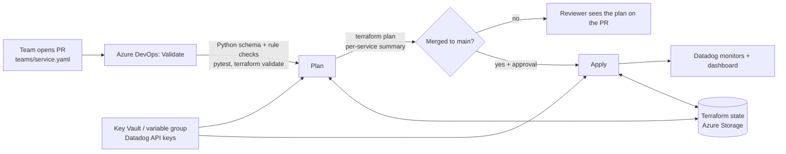

# Self-Service Monitoring Onboarding

Application teams get Datadog monitors, alerts and a dashboard for their service by
opening a pull request with one small YAML file. No tickets, no clicking through the
Datadog UI, and every alert follows the same standard.

```yaml
# teams/payments-api.yaml
team: payments
service: payments-api
env: dev
owner: payments-team@example.com
notify: ["@payments-team@example.com"]
monitors:
  latency_ms:     { warning: 400, critical: 800 }
  error_rate_pct: { warning: 2,   critical: 5 }
  cpu_pct:        { warning: 70,  critical: 85 }
  no_traffic:     { enabled: true }
```

Merge it, and the pipeline creates four monitors and a service dashboard with the
team's thresholds drawn on the graphs.

## How it works



| Part | What it does |
| --- | --- |
| `teams/*.yaml` | One onboarding request per service and environment |
| `schema/team.schema.json` | JSON Schema for the request format |
| `tools/validate_teams.py` | Rejects bad requests before Terraform runs: schema errors, warning ≥ critical, percentages over 100, duplicate service/env, wrong file name, prod without a runbook |
| `terraform/` | Reads every team file and calls the `team_monitoring` module once per service |
| `terraform/modules/team_monitoring` | Standard monitor catalog (latency, error rate, CPU, no traffic) and a service dashboard |
| `tools/plan_summary.py` | Turns `terraform plan` JSON into a per-service table for reviewers, and warns when a plan deletes monitors |
| `tools/emit_demo_metrics.py` | Simulates a service sending metrics, with an `--incident` mode to trigger alerts |
| `azure-pipelines.yml` | Validate → Plan on every PR; Apply on `main` after approval |
| `tools/bootstrap_state.sh` | Creates the Azure Storage account for remote Terraform state |

### Design decisions

- **Standard catalog, team-owned thresholds.** Teams choose which monitors they need and set the numbers. The queries, alert wording and tags are the same for everyone, so on-call engineers read every alert the same way.
- **Validation before Terraform.** A bad file fails in seconds with a clear message, not halfway through an apply.
- **Plan on PR, apply after merge and approval.** Nothing reaches Datadog without review.
- **Git is the source of truth.** Manual edits in the Datadog UI are overwritten on the next run; the runbook says to change the YAML instead.
- **Secrets stay out of the repo.** Datadog keys live in a variable group that can be linked to Azure Key Vault.

## Setup

You need: an Azure subscription, an Azure DevOps project, and a Datadog account
(the free 14-day trial works).

New to these tools? [docs/setup-walkthrough.md](docs/setup-walkthrough.md) walks through
every step on Windows with the reason behind it and what each output means.
[docs/windows-setup.md](docs/windows-setup.md) is the short version.

### 1. Datadog keys
In Datadog: **Organization Settings → API Keys** (create one) and **Application Keys**
(create one). Note your site from the URL, e.g. `us5.datadoghq.com`.

### 2. Terraform state in Azure
```bash
az login
./tools/bootstrap_state.sh canadacentral
cp terraform/backend.hcl.example terraform/backend.hcl   # fill in the printed values
```

### 3. Run locally first
```bash
pip install -r requirements.txt
python tools/validate_teams.py teams
python -m pytest

export DD_API_KEY=... DD_APP_KEY=...
cd terraform
terraform init -backend-config=backend.hcl
terraform plan -var="datadog_api_url=https://api.us5.datadoghq.com/"   # your site
terraform apply -var="datadog_api_url=https://api.us5.datadoghq.com/"
```
Commit `terraform/.terraform.lock.hcl` after the first `init` so the pipeline uses the same provider version.

### 4. Send demo traffic and trigger an alert
```bash
export DD_API_KEY=... DD_SITE=us5.datadoghq.com
python tools/emit_demo_metrics.py --service payments-api --env dev              # normal traffic
python tools/emit_demo_metrics.py --service payments-api --env dev --incident   # alerts fire within ~5 min
```

### 5. Azure DevOps pipeline
1. **Service connection:** Project Settings → Service connections → Azure Resource Manager, named `azure-monitoring-onboarding`, with access to the state resource group.
2. **Variable group** `datadog-onboarding` (Pipelines → Library): `DD_API_KEY` and `DD_APP_KEY` (mark as secret), `DD_API_URL`, `TFSTATE_RESOURCE_GROUP`, `TFSTATE_STORAGE_ACCOUNT`. Optionally link it to Azure Key Vault.
3. **Environment** `datadog-monitoring` (Pipelines → Environments) with an **Approvals** check.
4. Create the pipeline from `azure-pipelines.yml`.

## Onboarding a new service
1. Copy `teams/payments-api.yaml` to `teams/<your-service>.yaml` (or `<your-service>-prod.yaml`).
2. Set your team, owner, notification handles and thresholds.
3. Open a pull request. The pipeline validates it and posts the plan.
4. After merge and approval, your dashboard link appears in the Apply log.

## Cleaning up
```bash
cd terraform && terraform destroy -var="datadog_api_url=..."
az group delete --name rg-monitoring-tfstate
```
