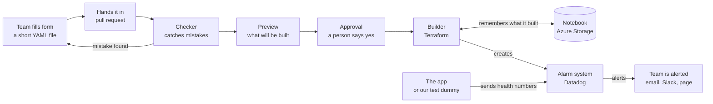

# The project, explained simply

This page explains what this project does and why it exists, using everyday comparisons.
No technical background needed. For the hands-on steps, see
[setup-walkthrough.md](setup-walkthrough.md).

## The short version

This project lets any team set up "smoke alarms" for their app by filling in a short form,
instead of waiting for an expert to install them by hand. The alarms watch the app and call
the right person the moment it gets slow, starts failing, or goes silent.

**The one-minute story:**

> Think of a big apartment building. Every apartment needs smoke alarms, and when one goes
> off, the people who live there get a call.
>
> In a tech company, the "apartments" are apps: the payments app, the orders app, the
> website. Each needs alarms too, not for fire but for problems like "the app is slow",
> "the app is showing errors" or "nobody can reach the app".
>
> Today, every team asks one expert to install their alarms by hand. It's slow, the expert
> is always busy, and every alarm ends up a little different.
>
> This project lets a team fill in a short form instead: "This is my app, call this person,
> warn me if it gets slower than this." Someone approves the form, and the alarms are
> installed automatically, the same way for everyone, with a screen showing how the app is
> doing.

The project doesn't build the alarm itself; that's a product called **Datadog**. It builds
the **automatic installation service** on top of it.

## The problem we're solving

When a company has dozens of apps and only a few experts who can set up alarms, the experts
become a bottleneck and every alarm comes out different.

Picture the apartment building again, with 200 apartments and **one** electrician allowed to
install smoke alarms:

- **Everyone waits.** A new family moves in and has no alarm for a week, because the
  electrician is booked.
- **Every alarm is different.** One is set very sensitive and goes off when someone makes
  toast. Another is barely sensitive and might miss a real fire. Nobody is sure what each
  one means when it beeps.
- **Nobody remembers who changed what.** A resident fiddles with their alarm, it stops
  working, and there's no record of what happened.
- **Mistakes slip in.** An alarm is installed backwards and never goes off.

Companies have exactly these problems with their apps:

| In the building | In a tech company |
| --- | --- |
| Apartments | Apps (payments, orders, the website) |
| Families living there | The teams that build and run each app |
| Fire, smoke | The app is slow, failing, or down |
| The one electrician | A platform engineer who sets up monitoring by hand |
| Waiting a week | Teams waiting days for a ticket to be done |
| Alarm goes off for toast | False alarms that wake people up at 3 a.m. for nothing |

When an app has a problem and nobody is alerted, **customers find out first**: a payment
fails, a page won't load, and they leave. Every minute matters.

## What "monitoring" means

Monitoring is keeping a constant eye on an app's health and raising the alarm when something
looks wrong, the way a security system watches a house.

| Security system | Monitoring (Datadog) | Example from this project |
| --- | --- | --- |
| Camera feeds and sensor readings | **Metrics**: numbers the app reports every few seconds | Response time, number of requests, number of errors, how busy the computer is |
| A rule like "if motion after midnight, sound the alarm" | **Monitor**: a rule that watches a metric | "If the app's average response time is above 800 milliseconds for 5 minutes, alert the team" |
| The control panel on the wall | **Dashboard**: a screen of live graphs | One screen per app, with the team's warning lines drawn on each graph |
| Calling the homeowner's phone | **Notification** | An email, Slack message or page to the team that owns the app |

**The four things we watch, in everyday terms:**

- **Latency (speed):** how long the app takes to answer. Like waiting in line at a shop:
  2 seconds is fine, 2 minutes means something is wrong.
- **Error rate:** what share of requests fail. Like a cashier who gives the wrong change once
  in 100 sales (normal) versus 15 in 100 (a problem).
- **CPU:** how hard the computer running the app is working. Like a car engine: cruising is
  fine, redlining for 10 minutes is not.
- **Traffic:** whether requests are arriving at all. Like a shop with no customers at noon:
  maybe the front door is locked.

**Warning and critical:** each alarm has two levels, like a fuel gauge. The **warning** is
the yellow light ("getting low, keep an eye on it"); **critical** is the red light
("act now").

**Datadog** is the monitoring product we use. It's one of the most widely used in industry,
along with tools like AWS CloudWatch and Azure Monitor.

## What this project does

It replaces "ask the expert and wait" with "fill in a form and it's done": a team writes a
short text file, someone approves it, and the alarms and dashboard are created automatically.

Think of ordering at a restaurant. You don't walk into the kitchen and cook. You fill in an
order slip, the waiter checks it ("we don't serve that"), and the kitchen makes it the same
way every time. This project is the order slip, the waiter and the kitchen for monitoring.

**The form a team fills in** looks like this. It's a plain text file in a format called YAML:

```yaml
team: payments
service: payments-api
env: dev
owner: payments-team@example.com
notify: ["@payments-team@example.com"]
monitors:
  latency_ms:     { warning: 400, critical: 800 }
  error_rate_pct: { warning: 2,   critical: 5 }
  cpu_pct:        { warning: 70,  critical: 85 }
  no_traffic:     { enabled: true }
```

In plain words: "I'm the payments team. My app is payments-api, in the test environment.
Contact this email. Warn me if responses take over 400 milliseconds and alert me over 800.
Warn me at 2% errors and alert at 5%. Same idea for CPU. And tell me if traffic stops
completely."

**What happens after:** that one file turns into four alarms and a dashboard in Datadog,
with no clicking.

**The important split:** teams choose **what** to watch and **the numbers**. The platform
(this project) decides **how** every alarm is written, so they all look and behave the same.
It's like a franchise: each restaurant picks its menu, but every kitchen follows the same
recipes.

## Every piece, with a real-life comparison

The project has nine parts; each one does a single job that you already know from everyday
life.

| Piece | Real-life comparison | What it actually does |
| --- | --- | --- |
| **Team file (YAML)** | The order slip at a restaurant | Says which app, who to contact, and the warning and alert numbers |
| **GitHub** | A shared filing cabinet that records every change | Stores all the files and keeps a history of who changed what, when and why |
| **Pull request** | Handing in a form for sign-off | A request to add or change a file, which someone reviews before it's accepted |
| **Validator (Python)** | A clerk who checks the form before it's processed | Catches mistakes in seconds, e.g. "your warning number is higher than your alert number" |
| **Terraform** | A builder who follows blueprints exactly | Reads the forms and creates the alarms and dashboards in Datadog automatically |
| **Terraform state (Azure Storage)** | The builder's notebook of everything already built | Remembers what exists, so nothing is built twice or forgotten. Kept in Microsoft's cloud so everyone shares one copy |
| **Pipeline (Azure DevOps)** | A conveyor belt in a factory | Moves each form through check, preview, approval and build, with nobody pushing it by hand |
| **Datadog** | The security system itself | Watches the apps, shows the graphs and sends the alerts |
| **Demo script** | A crash-test dummy | Pretends to be an app so we can test the alarms, including a fake outage |

**Why "code" instead of clicking?** If you click buttons on a website to create 200 alarms,
nobody can see what you did, repeat it exactly, or undo it cleanly. Writing it as files is
like using a recipe instead of cooking from memory: anyone can read it, follow it again, and
spot a mistake. This is called **infrastructure as code**.

## How the pieces connect



A team's form is handed in, checked and previewed; once a person approves it, the builder
creates the alarms in Datadog and writes what it built in its notebook. From then on, the app
sends its health numbers to Datadog, and Datadog alerts the team when something is wrong. If
the checker finds a mistake, the form goes back to the team to fix.

## One request, start to finish

Here is what happens when a new team, the inventory team, wants alarms for their app. In
total it takes minutes, not days.

1. **They copy the example form.** Priya on the inventory team copies the payments file,
   renames it `inventory-service.yaml`, and changes the team name, her email, and the
   numbers. Her app is usually fast, so she sets the warning at 300 milliseconds.
2. **She hands it in.** She opens a pull request on GitHub: "Please add monitoring for
   inventory-service."
3. **The clerk checks it.** Within seconds, the validator reads her file. She typed
   `env: production` by mistake, but only `dev`, `qa` or `prod` are allowed, so it rejects
   the file with a clear message. She fixes one word and submits again. This time it passes.
4. **The builder shows a preview.** Terraform prints exactly what it would create:
   "4 to add, 0 to change, 0 to destroy". Nothing is built yet.
5. **A reviewer approves.** A platform engineer reads the preview, sees four new alarms and
   nothing deleted, and clicks approve. This takes a minute, not a week.
6. **The builder builds.** Terraform creates the four alarms and the dashboard in Datadog,
   and writes them into its notebook.
7. **Priya gets her link.** The pipeline prints the dashboard address. Her app is now
   watched, around the clock, with alarms that work exactly like every other team's.

If she later wants to change a number, she edits the file and repeats the same steps. If
someone edits an alarm by hand in Datadog, the next run puts it back to match the file,
because **the file is the single source of truth**.

## When something goes wrong: the life of an alert

In our demo, a fake outage turned the alarms from green to yellow to red within about five
minutes, and back to green once it ended.

We used a script that pretends to be the payments app, like a crash-test dummy. First it
behaved normally, then we switched it to "incident mode" to simulate a bad day.

| Stage | What the app was doing | What the alarms showed |
| --- | --- | --- |
| Healthy | Answering in about 200 ms, about 1% errors | All green: **OK** |
| Problem starts | Answering in about 1,200 ms, about 15% errors, CPU over 90% | Graphs jump above the lines, alarms still green for a minute or two |
| Getting worse | Same, for a few minutes | Latency turns yellow: **WARN** |
| Real problem | Same | Error rate and latency turn red: **ALERT**. The team gets a message with the app name, how bad it is, who owns it, and a link to instructions |
| Fixed | Back to normal | Alarms turn green again and send a "recovered" message |

**Why the alarms waited a few minutes:** each one looks at the **average over the last
5 minutes**, not a single moment. One slow request is normal, like one long line at the shop.
Alerting on every blip would wake people up for nothing, and soon they would start ignoring
alarms. Waiting a few minutes means it only fires when the problem is real.

**Each alarm catches a different problem.** During the outage the app was slow and failing,
but still receiving traffic, so the "no traffic" alarm correctly stayed quiet. Later, when our
script stopped completely, that one fired instead: "the app has gone silent". Good alarms tell
you **what** is wrong, not just that something is.

**What the team does next:** they open the dashboard to see what's happening, follow the
**runbook** ([docs/runbook.md](runbook.md), a short checklist like a fire-escape plan) for
that alarm, and fix the cause, or roll back a recent change.

## "Don't AWS CloudWatch and Azure Monitor already do this?"

They do the watching, but none of them sets up the alarms for you. This project solves the
setup problem, whichever monitoring tool a company uses.

**1. Why use Datadog when the clouds have their own tools?**

Amazon (AWS) and Microsoft (Azure) each rent out computers to run apps, and each has a
built-in monitoring tool: CloudWatch for AWS, Azure Monitor for Azure. Each is built mainly
for its own cloud.

Many companies run apps in several places at once. Using only the built-in tools is like
having one security company for your house and a different one for your shop, each with its
own app, alarm rules and phone number. **Datadog is one security company that covers every
building**, whichever cloud it's in, on one screen. That's why many large companies pay for
it even though the built-in tools exist.

**2. If monitoring tools already exist, what's the point of this project?**

A smoke alarm brand doesn't install itself. Whether you buy CloudWatch, Azure Monitor or
Datadog, someone still has to create every alarm for every app, choose the numbers, decide
who gets called, and build the dashboards. With five apps that's fine by hand. With 200 apps
and 30 teams it becomes slow and inconsistent.

> CloudWatch, Azure Monitor and Datadog are the **smoke alarm brands**. This project is the
> **installation service**. It works with any brand: to switch from Datadog to CloudWatch,
> you'd keep the forms, checks, approvals and pipeline, and only swap the part that creates
> the alarms.

**Connecting clouds isn't the same thing either.** Letting an app in one cloud read a file in
another ("cross-cloud access") is like giving a neighbour the key to one room. It's about
**permission to use** something. Monitoring is the camera system: it's about **seeing**
whether everything is healthy. Giving someone a key doesn't give you cameras.

## Safety and trust

Every part gets only the access it needs, secrets never go into the shared files, and if
anything is tampered with the system can rebuild itself from those files.

**Keys instead of passwords.** Programs never use a person's login. They use **keys**, like
spare keys cut for one purpose. A key can be named, limited, and cancelled at any time without
changing your password. This project uses two:

| Key | Real-life comparison | What it can do |
| --- | --- | --- |
| API key | A mail slot | Only drop data in. It can't read or change anything |
| Application key | A door key | Create and change alarms and dashboards |

The keys are never written into the project's files. They're typed into the computer's memory
just for that session and vanish when the window closes. In the pipeline they live in a locked
secret store.

**Least privilege: give access to one room, not the whole house.** Datadog is a camera
company. You let it see the camera feeds, but you don't give it the key to your safe. When
companies connect Datadog to their cloud, it gets **read-only** access: it can see how healthy
things are, but it can't open files, delete anything or change settings.

**Datadog only sees what you send it.** It never reaches in to look around. This project sends
four harmless numbers (speed, errors, CPU, traffic) and no personal or customer data. The only
way private data could reach Datadog is if an app wrote it into its logs, which is like
leaving the safe open in front of the camera. Companies prevent this by not logging private
data, and by filters that hide things like card numbers.

**"What if Datadog gets hacked?"** It's a fair worry; security teams call it third-party risk.
The aim is to keep the **blast radius** small: how much damage one problem can cause.

- A hacker would find only health graphs, not customer data.
- Read-only access means they couldn't touch the company's cloud.
- Keys can be cancelled and replaced in minutes.
- Strong logins (single sign-on and two-factor) protect the account.
- Because the alarms are defined in files, anything a hacker changed or deleted is **rebuilt
  automatically** on the next pipeline run. It's like having the blueprints: if someone
  vandalises the building, you rebuild it exactly.

## Why companies care

Companies want problems caught before customers notice, without a handful of experts doing
every setup by hand. This project gives them that in five ways.

| Benefit | Before | After |
| --- | --- | --- |
| **Faster** | Teams wait days for a ticket | Alarms exist minutes after approval |
| **Fewer mistakes** | Typos found after something breaks | The checker rejects bad forms in seconds; a reviewer sees a preview first |
| **Consistent** | Every alarm written differently | Every alarm reads the same way, so whoever is woken at 3 a.m. understands it instantly |
| **Traceable** | Nobody knows who changed what | Every change is a reviewed, recorded pull request |
| **Recoverable** | A deleted alarm is gone | The files rebuild it on the next run |

The experts stop being installers and go back to improving the system for everyone, like the
electrician designing better alarms instead of screwing in every one.

**The job roles this matches:** this kind of work is done by **Platform Engineers**,
**DevOps Engineers** and **Site Reliability Engineers (SREs)**. Their job is to build the
tools and paved roads that let other teams ship and run apps safely on their own. This project
shows those skills end to end:

- **Terraform:** creating cloud resources from code
- **Datadog:** monitoring and alerting
- **Azure:** cloud storage and access
- **Azure DevOps:** automated pipelines with an approval step
- **Python:** the checker and the tests that prove it works
- **Git and GitHub:** reviewed changes through pull requests

## How to explain it to others

Use the shortest version that fits the moment; the story stays the same and only the detail
grows.

**30 seconds (friends, family, a recruiter's first call):**

> "Apps at big companies need alarms that go off when they get slow or break, a bit like
> smoke alarms. Setting those up used to mean waiting for an expert. I built a system where a
> team just fills in a short form, and the alarms and a live dashboard are created
> automatically, the same way for everyone."

**2 minutes (someone curious, non-technical):**

> "Every app a company runs needs watching: is it fast, is it failing, is anyone reaching it?
> A tool called Datadog does the watching and alerts the team when something's wrong. But
> someone still has to set up every alarm for every app, and with hundreds of apps that gets
> slow and messy.
>
> In my project, a team writes a short file saying 'this is my app, alert this person, and
> here are my limits'. They submit it for review. A checker catches mistakes straight away, a
> preview shows exactly what will be created, and once someone approves, the alarms and
> dashboard are built automatically. If anyone changes an alarm by hand, the system puts it
> back to match the file.
>
> I tested it with a fake app: I made it slow and full of errors, watched the alarms go from
> green to yellow to red, then fixed it and watched them recover."

**Interview (technical):**

> "I built a self-service observability onboarding platform. Teams onboard a service to
> Datadog by opening a pull request with one YAML file. An Azure DevOps pipeline validates it
> with a Python and JSON Schema validator, runs `terraform plan` and posts a per-service
> summary for reviewers, and after merge and manual approval applies a shared Terraform module
> that creates standard monitors and a dashboard with the team's thresholds. State lives in
> versioned Azure Blob Storage with locking, keys are pipeline secrets, and Git is the source
> of truth, so drift gets corrected on the next run. I tested the full alert life cycle with a
> metrics emitter that simulates incidents."

**Tip:** say the 30-second version out loud to someone with no tech background. If they can
repeat back "teams fill in a form and the alarms are set up automatically", you've explained
it well.

## Common questions

| Question | Simple answer |
| --- | --- |
| So you built a monitoring tool? | No. Datadog is the monitoring tool. This project sets up monitoring for any team automatically. |
| Does it fix the app when it breaks? | No. It tells the right people quickly and shows them what's wrong, so they can fix it faster. |
| Why not just click the buttons in Datadog? | Clicking can't be reviewed, repeated exactly or undone cleanly. Files can, like a recipe versus cooking from memory. |
| What stops a team making a mistake? | A checker rejects bad forms in seconds, and a person approves a preview before anything is built. |
| What if someone edits an alarm by hand? | The next run puts it back to match the file. The file is the single source of truth. |
| Why wait 5 minutes before alerting? | So a single slow moment doesn't wake someone at 3 a.m. It fires only when the problem lasts. |
| Can Datadog see customer data? | Only what you send it. This project sends four health numbers, no personal data. |
| What if Datadog is hacked? | They'd see health graphs, not customer data, and couldn't touch the company's systems. Keys can be cancelled, and the alarms rebuilt from the files. |
| Is it expensive to run? | The demo costs a few cents a month: one small storage account in Azure plus Datadog's free trial. |
| Could it work with something other than Datadog? | Yes. Swap the part that creates the alarms (the Terraform provider) and keep everything else. |
| Why Azure for the state? | Terraform needs one shared notebook that both the laptop and the pipeline can reach. A private, versioned Azure storage account does that safely. |

## Glossary in plain English

| Term | Plain meaning |
| --- | --- |
| App / service | A piece of software a company runs, like the payments system or the website |
| Monitoring / observability | Watching an app's health and being able to see what's happening inside it |
| Metric | A number an app reports over time, like response time or error count |
| Monitor | An alarm rule on a metric, with a warning level and a critical level |
| Dashboard | A screen of live graphs showing an app's health |
| Latency | How long the app takes to respond, measured in milliseconds (1,000 ms = 1 second) |
| Error rate | The percentage of requests that fail |
| CPU | How hard the computer running the app is working |
| Alert / page | A message sent to the team when an alarm fires |
| On-call | The person whose turn it is to respond to alerts, even at night |
| Runbook | A short checklist of what to do when a specific alarm fires |
| Datadog | A popular monitoring product that watches apps on any cloud |
| Cloud (AWS, Azure, GCP) | Companies that rent out computers and storage over the internet |
| YAML | A simple text format for writing settings, like a form |
| Git | A tool that records every change to a set of files |
| GitHub | A website that stores Git projects and hosts reviews |
| Pull request | A request to change files, reviewed before it's accepted |
| Terraform | A tool that creates cloud resources from text files ("infrastructure as code") |
| Infrastructure as code | Describing your setup in files so it can be reviewed, repeated and undone |
| Terraform state | Terraform's notebook of everything it has built |
| Pipeline (CI/CD) | Automation that checks and deploys changes step by step |
| Approval gate | A required human "yes" before anything is deployed |
| API | A doorway programs use to talk to a service |
| API key / application key | Passwords for programs: one to send data, one to change settings |
| Least privilege | Giving each person or program only the access it needs |
| Blast radius | How much damage a single problem can cause |
| Source of truth | The one place that decides what's correct, here the team files in Git |
