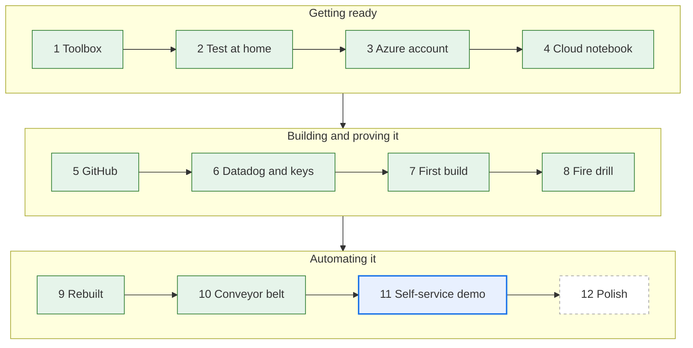

# Project journey, explained simply

This page tells the story of how this project was built, from an empty laptop to an
automated pipeline, in plain English. It says what was done at each stage, why, and what
was really happening, using everyday comparisons. No technical background needed.

- What the project is for: [project-explained.md](project-explained.md)
- The exact commands for every step: [setup-walkthrough.md](setup-walkthrough.md)

## The short version

We went from an empty laptop to a system that sets up app alarms automatically. We proved
it with a fake outage, rebuilt it in seconds when an account expired, and then handed the
whole job to an automatic pipeline that waits for a person's approval before changing
anything.

1. **Got the tools** onto the laptop, like stocking a toolbox before a job.
2. **Tried the project at home first** and broke it on purpose to watch the safety checks
   catch the mistake.
3. **Opened a Microsoft cloud account (Azure)**, like renting space in a secure warehouse.
4. **Built a notebook in the cloud** where the builder writes down everything it builds.
5. **Saved the work to GitHub** through reviewed requests, the way real teams do.
6. **Signed up for Datadog**, the alarm system, and got two special keys.
7. **Did the first real build:** two text files became 6 alarms and 2 dashboards.
8. **Ran a fire drill:** made a fake app slow and broken, watched the alarms go off, then
   recover.
9. **Lost an account and rebuilt everything** from the files with one command.
10. **Built the conveyor belt:** an Azure DevOps pipeline now checks, previews and, after
    approval, builds every change by itself.

## The journey at a glance



Green stages are done, blue is next, dashed is still to come.

## The idea behind it all

Apps need alarms. Setting them up by hand is slow and messy, so we built a
form-and-robot system that sets them up automatically.

Picture a big apartment building where every apartment needs smoke alarms. Only one
electrician is allowed to install them, so new families wait a week, and every alarm ends
up set differently: some go off for toast, some might miss a real fire.

In a tech company, the "apartments" are apps: a payments app, an orders app, a website.
They need alarms too, for problems like "the app is slow", "the app is failing" or
"nobody can reach the app". When nobody is alerted, customers find out first.

In this project, a team fills in a short form saying "this is my app, call this person,
warn me at these limits". A checker reviews the form, a person approves it, and a robot
builder installs the alarms and a live screen of graphs, the same standard way for every
team.

| Real thing | Everyday comparison |
| --- | --- |
| A team's settings file (YAML) | The order form |
| The checker (Python validator) | A clerk who checks the form for mistakes |
| Terraform | A builder who follows blueprints exactly |
| Terraform state, kept in Azure | The builder's notebook of everything already built |
| Datadog | The alarm and camera system itself |
| GitHub and pull requests | A shared filing cabinet, and handing in a form for sign-off |
| The demo script | A crash-test dummy that pretends to be an app |
| The Azure DevOps pipeline | A conveyor belt that moves each form through every step on its own |

## Stage 1: Getting the toolbox ready

We installed five free programs on the Windows laptop, the way a carpenter stocks a
toolbox before starting a job.

| Tool | What it's for | Everyday comparison |
| --- | --- | --- |
| Git | Downloads the project and records every change | A notebook that tracks every edit |
| Python | Runs the checker, the tests and the crash-test dummy | A calculator that follows written instructions |
| Terraform | Builds the alarms from text files | The builder |
| Azure CLI | Lets the laptop talk to Microsoft's cloud | A phone line to the warehouse |
| VS Code | Where we read and edit files | A word processor for code |

We typed install commands into the Command Prompt, then checked each tool by asking for
its version number. Terraform printed "your version is out of date", which turned out to
be a harmless reminder, not an error.

## Stage 2: Trying it out at home first

Before touching any online service, we ran the project on the laptop and proved its
safety checks work, like a chef testing a recipe at home before cooking for guests.

1. **Downloaded the project** into `D:\projects`, not the Desktop, because the Desktop
   syncs to OneDrive, which would try to upload thousands of small working files.
2. **Made a private sandbox** for the project's Python helpers (a virtual environment),
   like giving the project its own drawer so its tools don't mix with anything else.
3. **Installed the helpers** to read the forms, check them, talk to Datadog and run tests.
4. **Ran the checker:** "2 files checked, all valid."
5. **Ran the automatic tests:** small scripts that prove each part behaves correctly.

**Breaking it on purpose:** we set a warning level (900) higher than the alarm level
(800), like a fuel gauge whose yellow light comes on after the red one. The checker
refused it straight away, naming the file, the setting and how to fix it. In real use, a
team's mistake is caught in seconds, before anything is built.

## Stage 3: Opening an Azure account

We needed a small, safe place on the internet to keep the builder's notebook, so we
opened a Microsoft Azure account with free starting credit.

**Why the cloud, not the laptop?** The automatic pipeline also runs the builder. If the
notebook lived only on the laptop, the pipeline couldn't read it, and the two would
disagree about what exists. A shared copy in the cloud means one truth.

**Account versus subscription:** the first login said "No subscriptions found". It's
like a library card with no borrowing rights: the account proves who you are, but the
subscription is what lets you actually use and pay for things. The old trial had expired,
so we opened a fresh account.

**Extra security later:** Microsoft started requiring a second check (multi-factor
authentication) for cloud management, like a bank texting you a code. Signing in to our
specific area of Azure (the tenant) brought up that prompt.

## Stage 4: Building the builder's notebook in the cloud

We created a private, locked, self-backing-up storage space in Azure where Terraform keeps
its record of everything it builds.

**Why the builder needs a notebook:** imagine a contractor with no memory. Every visit
they'd build the same houses again, and they'd never know which ones to knock down when a
customer cancels. Terraform's notebook (called **state**) records "alarm 12345 belongs to
the payments app", so it updates instead of duplicating and cleans up exactly what it
built.

```
Azure subscription           the warehouse company
└── resource group           a labelled section of the warehouse
    └── storage account      a private locker
        └── container        a drawer inside the locker
            └── state file   the notebook (written by Terraform itself)
```

- The locker is **private** (nobody on the internet can peek in) and **encrypted**.
- **Versioning** keeps every old copy of the notebook, like automatic photocopies before
  every change, so a bad build can be rolled back.
- **Locking** stops two builders writing in the notebook at the same moment.
- The locker's address lives in a settings file kept off GitHub, so private details never
  become public.

## Stage 5: Saving our work to GitHub the professional way

Every change went into the shared project through a reviewed request, never by editing
the main copy directly.

Think of an official rulebook kept at an office. You never scribble in it. You photocopy
the page, edit the copy, hand it in with a note saying what changed and why, someone
reviews it, and only then is it filed.

| Git word | Everyday meaning |
| --- | --- |
| `main` | The official rulebook |
| Branch | Your photocopy to work on |
| Commit | Saving your edits with a short note |
| Push | Sending your copy to the office |
| Pull request | Handing it in for review |
| Merge | Filing it into the official rulebook |
| Pull | Updating your own copy to match the rulebook |

Two lessons from this stage:

- **The wrong login.** The first upload was refused because Windows remembered a
  different GitHub account, like a phone auto-filling an old password. We cleared the
  saved login and signed in again.
- **Review catches mistakes.** Checking a change on GitHub showed one old line had been
  left behind, which would have broken a script. It was fixed before being accepted.

## Stage 6: Signing up for Datadog and getting the keys

We opened a free Datadog trial and created two keys, so our programs could use it
without ever knowing a personal password.

Datadog is a security system for apps: it collects health numbers (metrics), checks them
against rules (monitors), shows them on screens (dashboards), and calls the team when
something's wrong.

| Key | Everyday comparison | What it can do |
| --- | --- | --- |
| API key | A mail slot | Only drop data in |
| Application key | A door key | Create and change alarms and screens |

The keys were kept in a file outside the project and outside OneDrive, handed to programs
only for one session, and checked by showing just their first four characters. That habit
caught a mix-up straight away: the example text "paste-your-key-here" had been typed
instead of the real key, and its first four characters read "past".

## Stage 7: The first real build

Two short text files became 6 working alarms and 2 live dashboards in Datadog, in about
15 seconds, without a single click in Datadog.

1. **Got its tools ready (`terraform init`):** downloaded the Datadog translator,
   connected to the notebook, and recorded the translator's exact version.
2. **Gave a quote (`terraform plan`):** like a contractor's written estimate: "8 to add,
   0 to change, 0 to destroy". Nothing was built yet. The number to always check is
   destroy.
3. **Built it (`terraform apply`):** only after typing `yes`.

The payments team asked for all four alarms (speed, errors, CPU, no traffic); the orders
team turned two off in their form, so they got two. In plain words, one rule reads: "If
the payments app's average response time over the last 5 minutes is above 800
milliseconds, alert the team. Warn them at 400." The numbers came from the team's form;
the rest is the same for everyone.

## Stage 8: The fire drill

We made a fake app behave badly and watched the alarms go from green to yellow to red,
then back to green once it was fixed.

Buildings run fire drills because an alarm nobody has heard go off can't be trusted. Our
crash-test dummy pretends to be the payments app and has a normal mode and an incident
mode.

| Stage | What the fake app did | What the alarms showed |
| --- | --- | --- |
| Normal | About 200 ms, about 1% failures | All green |
| Incident starts | About 1,200 ms, about 15% failures, CPU over 90% | Graphs above the lines; alarms still green for a minute or two |
| A few minutes in | Same | Speed alarm yellow (warning), failure alarm red (alert) |
| Fixed | Back to normal | All green again, with a "recovered" message |

The alarms waited a few minutes because each judges the **average over 5 minutes**, so a
single slow moment doesn't wake someone at 3 a.m. Each alarm caught a different problem:
during the incident the app still had visitors, so the "no traffic" alarm stayed quiet;
when the dummy stopped completely, that one noticed the silence instead.

A brief internet hiccup crashed the dummy partway through. We changed it to note the error
and try again 10 seconds later, giving up only if the key is wrong, and added tests that
recreate the exact crash.

## Stage 9: When the free trial ran out

The first Datadog trial ended. We pointed Terraform at a fresh Datadog account and it
rebuilt all 6 alarms and 2 dashboards in about 10 seconds, because everything was written
down in files.

If a building burns down and you kept the **blueprints**, you hand them to a builder and
get the identical building back. Our team forms and Terraform files are the blueprints.
The quote said "8 to add, 0 to destroy" (the new account had never heard of the old
alarms), and the build recreated everything; only the dashboard links changed.

## Stage 10: Building the conveyor belt

We handed the whole job to an automatic pipeline in Azure DevOps. It checks every change,
shows the quote, and builds only after a person approves.

Until now a person was the conveyor belt, typing every command by hand. That works for a
demo, not for 30 teams. Now:

```
A team proposes a change on GitHub   ->  check  ->  quote
The change is accepted               ->  check  ->  quote  ->  a person approves  ->  build
```

What we set up, in everyday terms:

| What we set up | Everyday comparison | Why |
| --- | --- | --- |
| Upgraded Azure to pay-as-you-go, with a $5 budget alert | Switching a trial membership to a regular one, with a spending text alert | Azure DevOps won't link to a free trial, and the trial would have shut down the notebook |
| Azure DevOps organization and project | The factory building | Where the conveyor belt lives |
| Linked billing (free tier) | Getting the factory's free machine switched on | One free build machine, 1,800 minutes a month |
| Service connection | A staff badge for the robot | Lets the pipeline reach the notebook, limited to one section of the warehouse, with no stored password |
| Variable group | A locked safe | Holds the Datadog keys; they never appear in the code or the logs |
| Environment with an approval check | A supervisor's sign-off at the last station | Nothing reaches Datadog without a person's "yes" |
| The pipeline itself | The conveyor belt | Reads its instructions from the project on GitHub |

**How the robot logs in without a password:** a person signs in with a password and a
code on their phone. A robot can't use a phone, so for every run Azure DevOps asks
Microsoft for a **short-lived pass** that proves "I am this pipeline" (workload identity
federation). A small script hands that pass to the builder so it can open its notebook.
The pass expires on its own, so there's no password to leak.

**The first run:** the checks passed, but the quote step stopped with "invalid character
in URL". An invisible Tab character had been pasted at the end of the Datadog address in
the safe. Retyping the address by hand fixed it, and the next run was green from start to
finish: check, quote ("no changes", because everything already matched), approval, build.

## Problems we hit, and what each taught us

| Problem | What was really going on | Lesson |
| --- | --- | --- |
| "No subscriptions found" in Azure | The old free trial had expired | An account isn't enough; you need an active subscription |
| Commands failed in a new window | It was PowerShell, not the Command Prompt | Check which terminal you're in; typing `cmd` switches |
| Keys showed "past..." | The example text was typed instead of the real key | Check secrets safely, by their first four characters only |
| "Not recognized" errors after pasting script lines | Lines meant for a file were typed into the Command Prompt | Know whether text goes in a file or a terminal |
| GitHub upload refused (403) | Windows remembered a different GitHub account | Saved logins can belong to the wrong person |
| A leftover line in a script | An edit didn't fully replace the old line | Review a change before accepting it |
| Crash-test dummy crashed | A brief internet hiccup | Retry temporary failures; stop only on permanent ones |
| Datadog trial ended | Free trials expire | Because everything is code, rebuilding took one command |
| Azure asked for multi-factor login | Microsoft now requires it for cloud management | People use MFA; pipelines use dedicated non-human identities |
| The free build machine request link was dead | Microsoft replaced the form with billing linking | Check current documentation; processes change |
| "You do not have access" (401) in Azure DevOps | The browser had switched to another Microsoft account | Keep one browser profile per set of accounts |
| "Invalid character in URL" in the pipeline | A hidden Tab was pasted into a setting | Type short values by hand; read errors closely |

## What comes next

1. **The self-service demo.** A new pretend team (inventory) hands in a form through
   GitHub, and we watch the conveyor belt check it, quote it, wait for approval and build
   their alarms, with nobody touching Terraform. We'll also submit a broken form first to
   watch the pipeline block it.
2. **Polish.** Add screenshots of the fire drill and the pipeline to the project page, add
   an open-source licence, and practise explaining the project.

When it's all done, a team gets working alarms by handing in one short form and waiting
for one approval: fast, consistent and safe, with nobody waiting on an expert.
